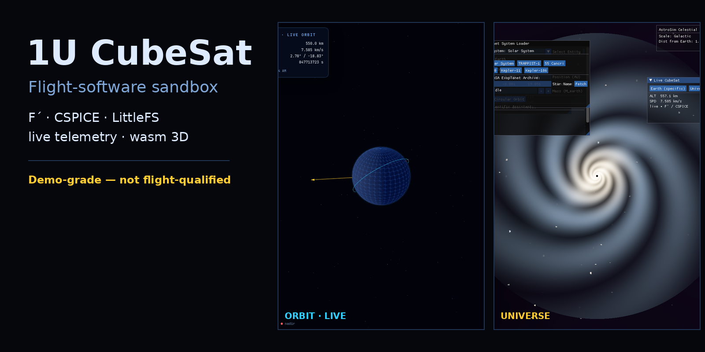
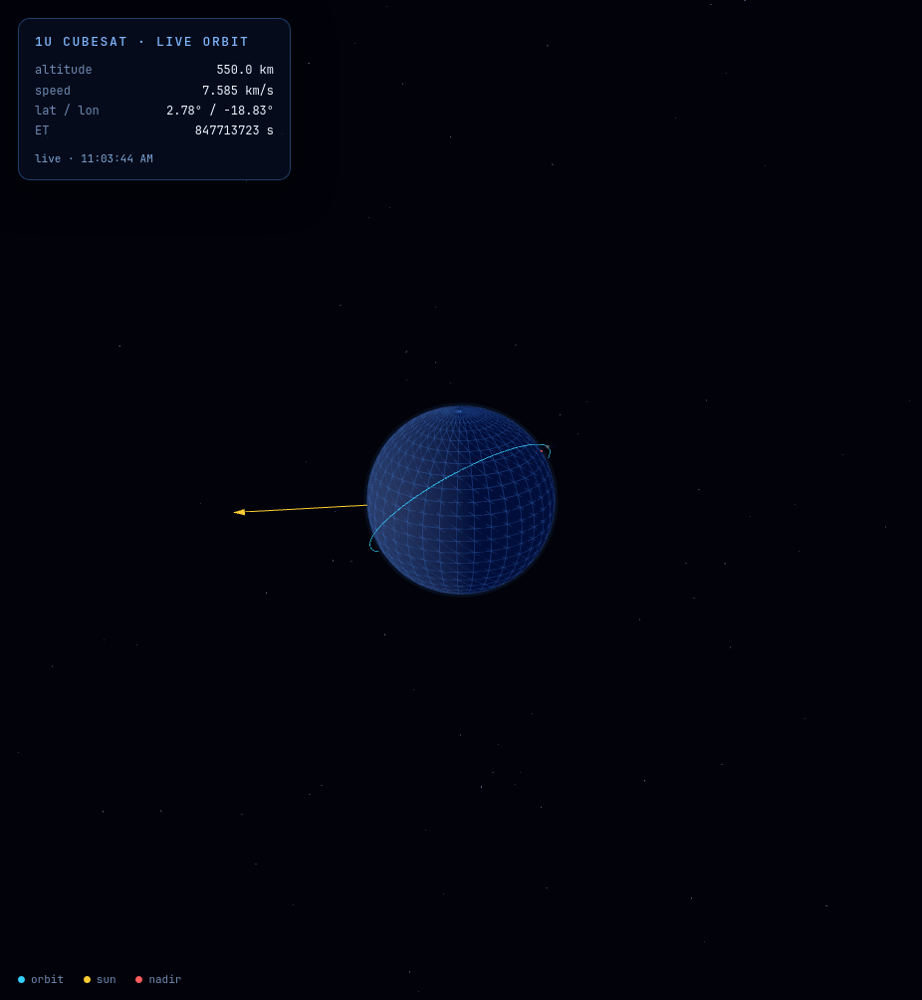
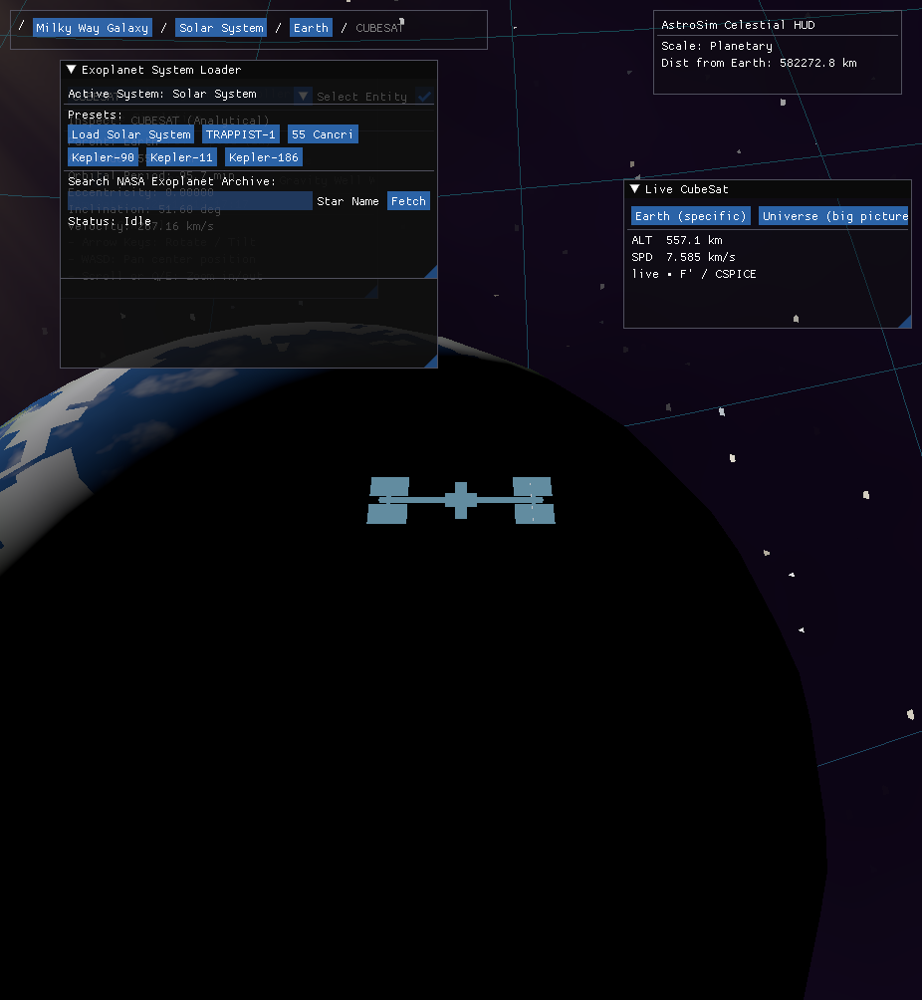
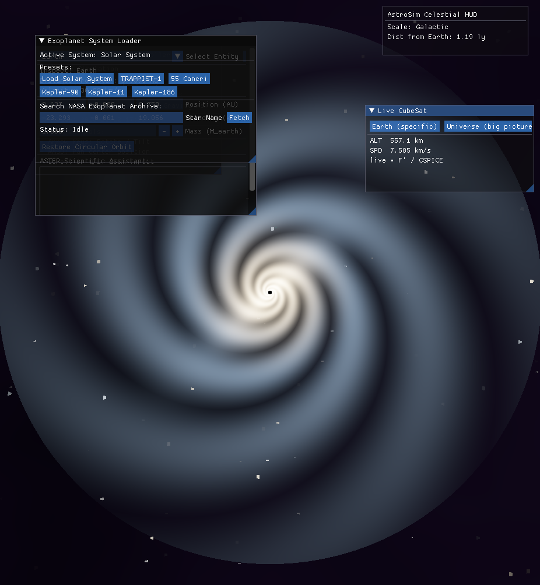
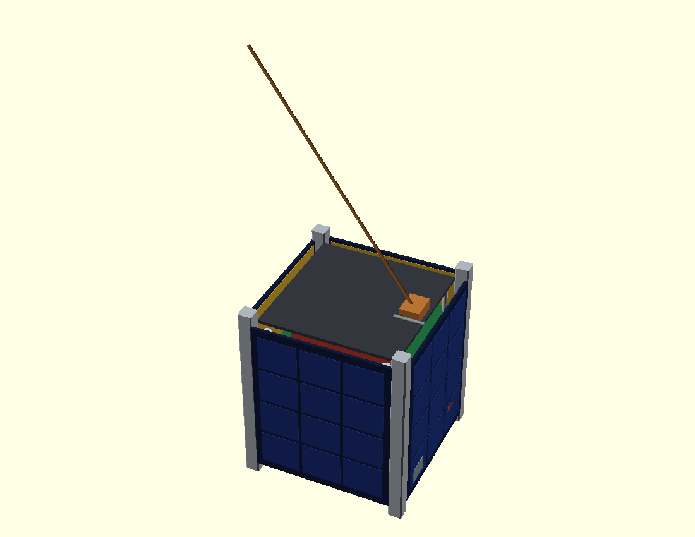

# 1U CubeSat — F´ flight-software sandbox



A demo-grade 1U avionics sandbox built around NASA F´: a duty-cycled power
supervisor with a battery-reserve guard, a power-loss-safe LittleFS store, a
C++23 CSPICE astrodynamics wrapper, and live telemetry rendered both in a
Three.js orbit view and inside a patched AstroSim (Rust, wgpu, ImGui). The
repo also carries the OpenSCAD 1U packaging model and a synthetic LEO
ephemeris.

[](https://github.com/yahya-azeem/cubesat-fsw/actions/workflows/ci.yml)
[](LICENSE)

> **Demo-grade — not flight-qualified.** Synthetic ephemeris, no hardware
> qualification, packaging CAD only.

## One command

```bash
git clone --recurse-submodules https://github.com/yahya-azeem/cubesat-fsw.git
cd cubesat-fsw
./setup/install.sh && ./setup/install-fprime.sh && ./setup/install-cspice.sh
make check
```

`make check` runs **146 host assertions** (power, LittleFS, CSPICE) and
**14 F´ component tests**. `install.sh` targets Arch/CachyOS; Debian/Ubuntu
use the apt block in `.github/workflows/ci.yml`.

[48-second captioned demo reel](docs/demo.mp4) ·
[live orbit view](integrations/orbit-view/) ·
[AstroSim integration](integrations/astrosim/)

## What is here

- **PowerCore** — milliwatt-second energy accounting, 20 % reserve, fail-closed
  `Safe → Charge → AwaitPass → Downlink` supervisor.
- **Storage** — vendored LittleFS with RAM and SPI-NOR backends; brown-out
  and corrupt-superblock tests.
- **Spice** — bounded C++23 `std::expected` wrapper around NAIF CSPICE.
- **AstroNav** — 1 Hz ephemeris telemetry from a demo SPK.
- **GDS demo** — command the state machine and watch the PA gate and battery
  guard from the browser or `fprime-cli`.
- **Visuals** — Three.js live orbit, AstroSim wasm with ImGui Earth/Universe
  modes, literal OpenSCAD 1U STL mesh.
- **CAD** — parametric 1U model with a manifold checker.

## Layout

```
cubesat-fsw/
├── fsw/                      # F´ 4.4 deployment + host tests
│   ├── tests/{test_power,test_storage,test_spice}.cpp
│   └── fprime/cubesat-fsw/
│       ├── Cubesat/{PowerCore,Storage,Spice,Components}
│       └── CubesatDeployment     # topology + 1 Hz rate group
├── integrations/
│   ├── orbit-view/            # Three.js live telemetry view
│   └── astrosim/              # AstroSim wasm patch, bridge, embed page
├── cad/                      # OpenSCAD 1U model + STL checker
├── docs/                     # hero, social preview, demo reel
├── avr/ riscv/ rust/         # toolchain demos and reference models
├── setup/                    # system, F´ venv, CSPICE installers
└── .github/workflows/ci.yml
```

## Toolchain notes

The F´ venv has both activate scripts. **fish** cannot parse bash's
`activate`:

```fish
source ~/Projects/embedded/.venv-fprime/bin/activate.fish
```

For bash/zsh use `bin/activate`. The Makefile sources it under `/bin/bash`,
so `make` targets work from either shell.

## Flight software (C++ / F´)

```bash
make fsw           # 146 host assertions across three suites
make fprime        # build the F´ deployment (PowerManager + DataStore)
make fprime-ut     # 14 F´ component tests (fprime-util check + GTest)
make fprime-run    # boot it headlessly; LittleFS prints StorageReady
make fprime-gds    # browser GDS on http://localhost:5000
```

`fsw/fprime/cubesat-fsw` is a real F´ 4.4 project, C++20:

- **PowerCore** — milliwatt-second battery accounting with a 20 % reserve,
  the `Safe → Charge → AwaitPass → Downlink` supervisor, CCSDS TM header.
- **Storage** — vendored LittleFS 2.11.2 behind a static `FileStore`;
  formats only blank media and fails closed on corruption.
- **PowerManager** — passive component; checks `discharge(13 W, 300 s)`
  before keying the PA, latches a fault otherwise.
- **DataStore** — passive component; appends 8-byte housekeeping records to
  `hk.log` at 1 Hz.
- **AstroNav** — passive component; loads CSPICE kernels and publishes
  altitude, speed, position, velocity, Sun vector and sub-satellite point at
  1 Hz from the demo SPK.
- **Spice** — C++23, `std::expected`-based wrapper around NAIF CSPICE:
  bounded strings, RETURN error mode, finite-state and orthonormal-matrix
  checks, RAII kernels. See `fsw/fprime/cubesat-fsw/Cubesat/Spice/README.md`.
- **CubesatDeployment** — both instances on `rateGroup_1Hz` slots 6 and 7,
  with the deployment's telemetry/event/time pattern connections.

The test suite covers the full 4×7 mode/event matrix, a four-orbit energy
simulation, CCSDS edge cases, LittleFS brown-out recovery, append across
remounts, device-full, corrupt-superblock fail-closed and wear erases. It
already caught a real defect: `charge(1500 mW, 1 s)` truncates to 0 mWh, so
accounting is now in milliwatt-seconds.

Compiled with `-std=c++20 -Wall -Wextra -Wpedantic -Wshadow -Wconversion
-Wsign-conversion -Werror -fno-exceptions -fno-rtti`, no heap, no virtual
dispatch in the rate-group path.

Note: the venv pins **CMake 3.31** because F´ 4.4's install step fails under
CMake 4.x. `fprime-util` needs the venv on `PATH`.

### Rust inside F´

Correcting my earlier claim: F´ does support Rust, but only through
`Svc::WasmSequencer` — sequences compile to Wasm and run isolated; the
component/topology layer stays C++ and autocoded. The build system picks up
`cargo`/`rustc` when present. That is the boundary this repo follows:
`rust/` is a host-side oracle and QEMU sandbox, never a flight component.

## GDS showcase

Start it in one terminal:

```bash
make fprime-gds      # http://localhost:5000
```

Then in another terminal, drive a whole pass:

```bash
make gds-demo
```

What the UI gives you:

- **Channels** — tick `CubesatDeployment.dataStore.Records`, `powerManager.Mode`,
  `powerManager.SocPermille`, `radioDriver.PaState` to plot them live.
- **Events** — `StorageReady`, `PaKeyed`, `PaInhibited`, `FaultLatched`, with
  severity filters.
- **Commands** — the four `powerManager.*` commands appear with their opcodes;
  the same ones the script sends.
- **Uplink / sequences** — upload a file or a compiled command sequence; the
  deployment already has `Svc.FileUplink` and `Svc.CmdSequencer` wired.

Command-line equivalents (from `fsw/fprime/cubesat-fsw`, venv active):

```bash
export D=build-artifacts/Linux/CubesatDeployment

fprime-cli command-send -d $D --list -c CubesatDeployment.powerManager
fprime-cli command-send -d $D CubesatDeployment.powerManager.CLEAR_FAULT
fprime-cli channels     -d $D -c CubesatDeployment.dataStore
fprime-cli events       -d $D -s Fault
```

The demo sequence and the expected telemetry:

| Command | Mode | What happens |
|---|---|---|
| `CLEAR_FAULT` | 1 Charge | 1 Hz harvest starts, `SocPermille` climbs |
| `PASS_SCHEDULED` | 2 AwaitPass | pass imminent, PA still inhibited |
| `PASS_ACQUIRED` | 3 Downlink | PA keyed, `PaKeyed`, 1.08 Wh reserved |
| `DOWNLINK_COMPLETE` | 1 Charge | `PaInhibited` |
| `PASS_ACQUIRED` again | 0 Safe | energy guard refuses: `FaultLatched 0xE0B1` |

That last row is the point: the battery guard is enforced in the component,
not in the UI, so the same refusal happens from the GDS, a script, or the
flight sequencer.

## Live 3D view



`integrations/orbit-view` is a zero-build Three.js view of the live AstroNav
telemetry: Earth, the predicted orbit, the satellite, the Sun vector and the
nadir point. It reads the newest GDS channel log through a small Python
bridge, so the flight software knows nothing about the web UI.

```bash
python3 integrations/orbit-view/serve.py     # http://localhost:8787
```

`integrations/astrosim` takes this further: it patches
[yahya-azeem/AstroSim](https://github.com/yahya-azeem/AstroSim) (Rust + wgpu
+ ImGui) with the literal **OpenSCAD 1U STL** as a live `CUBESAT` mesh and
an ImGui **Live CubeSat** panel with two modes:

| Mode | View |
|---|---|
| Earth (specific) | follows Earth at 0.007 AU, live orbit and altitude/speed |
| Universe (big picture) | the full AstroSim galactic-scale simulation |

```bash
./integrations/astrosim/build-wasm.sh   # emsdk + wasm-bindgen required
```

It is iframe-embeddable (`?mode=earth|universe&endpoint=...`) and exposes
`window.AstroSim` plus a `postMessage` API (`astrosim:setMode`,
`astrosim:getState`). See `integrations/astrosim/README.md` for the data flow,
API and run steps.

| Earth | Universe |
|---|---|
|  |  |

## Physical model (OpenSCAD)



Parametric 1U envelope in `cad/cubesat.scad`: 100 mm body, 8.5 mm rails,
body-mounted solar cells, four-board stack, S-band patch and deployable UHF
whip. `cad/README.md` maps each feature to the subsystem and documents the
caveats (it is a packaging model, not structural analysis).

```bash
make cad            # cubesat.stl + cubesat-exploded.stl
make cad-check      # watertight: 0 non-manifold edges, 0 degenerate triangles
make cad-preview    # assembly / exploded / stack PNGs
```

`u = 1..3` changes the envelope; `explode`, `show_panels`, `show_stack` and
`show_antenna` control the view. OpenSCAD is not installed by
`setup/install.sh` because it is optional: `sudo pacman -S openscad`, or use
the upstream AppImage.

## Emulation

```bash
make avr          # AVR build -> build/firmware.{elf,hex}
make sim          # simavr, UART to stdout (5 s cap)
make vcd          # 1.2 s of execution -> VCD
make wave         # gtkwave: PB0..PB7, PD0..PD7
make riscv        # C rv32 build (QEMU virt)
make run-riscv    # headless boot
make debug-avr    # simavr -g + avr-gdb
make debug-riscv  # qemu -S + gdb
```

AVR note: Arch's `simavr` is built **without libelf**, so it cannot read
`.elf`. `make sim`/`make vcd` use `firmware.hex`; the VCD harness links
`libsimavr` and loads Intel HEX directly. Verified transitions: PB5 at
18 ms, 525 ms, 1030 ms with a 500 ms blink.

QEMU has no VCD backend. For RISC-V use `-d in_asm,cpu -D qemu.log` or
`-trace`; gtkwave is wired for AVR only.

### ESP32 reality

Arch's `qemu-system-xtensa` ships only DC232b boards — **no `esp32`
machine** (checked with `-M help`), and `qemu-system-riscv32` has no
`esp32c3`. Emulating ESP32 needs Espressif's QEMU fork or ESP-IDF's
`idf.py qemu`; see `esp32/README.md`.

## Rust sandbox

```bash
make rust             # core tests + both images
make rust-test        # 15 host tests
make rust-riscv-run   # boots in QEMU, prints ticks
make rust-arm         # links the Cortex-M4 skeleton
```

Rust editions of the same policy (`rust/cubesat-core`) exist as an executable
spec: they are useful for cross-checking the C++ implementation, not for
flight. The VA41620 HAL question is covered by `tools/gen-pac.sh`; there is
no public SVD, so point it at the vendor DFP.

## Design-doc reality checks

- **1.5 W orbit-average from a 1U body-mounted array is optimistic**
  (measured units: ~0.6–1.2 W). At 0.8 W the 300 s burst is ~60 % of the
  harvest, not 48 %. Keep the reserve and load shedding.
- **−105 dBm sensitivity is not valid at 4.3 Mbps.** Required carrier is
  ≈ `−174 + 10log₁₀(Rb) + Eb/N0` ≈ −103 dBm before ~2 dB implementation
  loss. Your −98 dBm gives ~3 dB margin at max rate, not 7; 2 Mbps is the
  robust mode.
- **12 W DC for 33 dBm ≈ 10 W of heat** in a 10 cm cube. Duty cycling fixes
  energy, not junction temperature — model the burst thermal transient.
- **No public VA41620 SVD**; the memory map in
  `rust/firmware-va41620/linker.ld` is a placeholder, not a datasheet.


## License

Apache-2.0. NASA F´ is Apache-2.0 and lives in the `lib/fprime` submodule;
AstroSim is patched locally and not redistributed.
