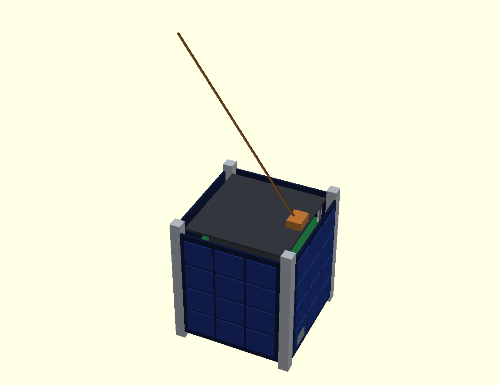
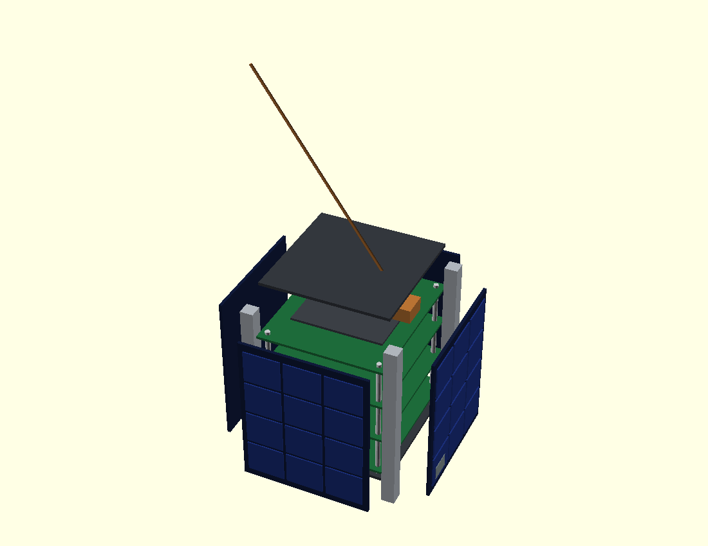
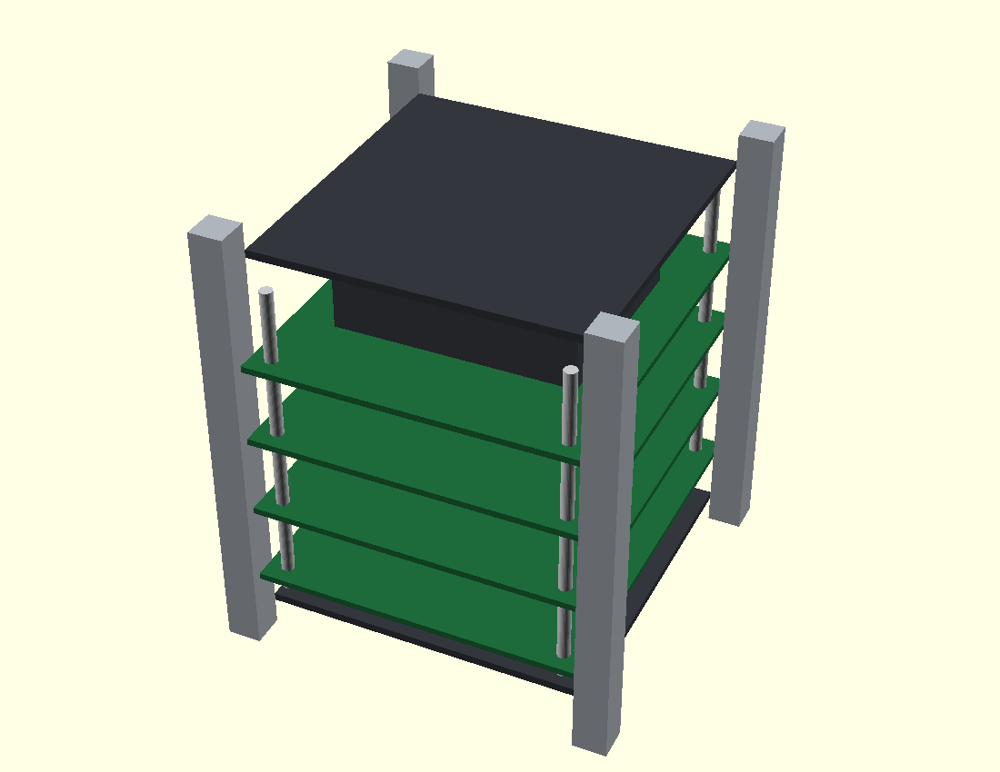

# 1U CubeSat packaging model (OpenSCAD)

Parametric mechanical envelope for the 1U architecture in the main README.
It is a **packaging/visual model**, not a structural, thermal or tolerance
analysis. Wall thicknesses and clearances are indicative.

| Parameter | Value |
|---|---|
| Envelope | 100 × 100 mm body, 113.5 mm rail length (1U) |
| Rails | 8.5 × 8.5 mm, four corners |
| Body | 100 mm cube between rails |
| Panels | 83 mm wide, 2 mm thick, body-mounted cells |
| Board stack | 82 × 96 mm PCBs on M3 standoffs |
| Units | `u = 1, 2, 3` (body and rails scale; stack stays 1U) |

## Views

| Assembly | Exploded | Stack |
|---|---|---|
|  |  |  |

## Render

```bash
# system package (recommended)
sudo pacman -S openscad

make cad            # cubesat.stl + cubesat-exploded.stl
make cad-preview    # PNGs (needs a display or xvfb)
```

Without installing, the official AppImage works:

```bash
curl -LO https://files.openscad.org/OpenSCAD-2021.01-x86_64.AppImage
chmod +x OpenSCAD-2021.01-x86_64.AppImage
./OpenSCAD-2021.01-x86_64.AppImage -o cubesat.stl cad/cubesat.scad
```

Useful overrides:

```bash
openscad -D 'u=3'                 -o 3u.stl   cad/cubesat.scad
openscad -D 'explode=0.6'         -o x.stl    cad/cubesat.scad
openscad -D 'show_panels=false'   -o stack.stl cad/cubesat.scad
openscad -D 'show_antenna=false'  -o stowed.stl cad/cubesat.scad
```

## What maps to what

| Model feature | Subsystem |
|---|---|
| Four PCB layers in the stack | EPS, OBC (VA41620), S-band/UHF radio, payload |
| Gold plate on the nadir face | S-band patch antenna |
| Copper whip on the top corner | deployable UHF telecommand antenna |
| Dark blue 3×4 cell arrays | body-mounted solar strings |
| Red tab on +X | remove-before-flight / kill switch |
| Grey block on +X | access / data port |

## Caveats

- The STL is a union of packaging parts and is not guaranteed manifold at
  every panel/rail interface; run a mesh repair pass before printing.
- No fasteners, harness, MLI, or deployer mechanisms are modelled.
- Rail chamfers and the 6.5 mm rail cut-outs from the CubeSat Design
  Specification are omitted for clarity.
- The internal stack is illustrative: real boards need a keep-out and
  harness routing check against the rails.
