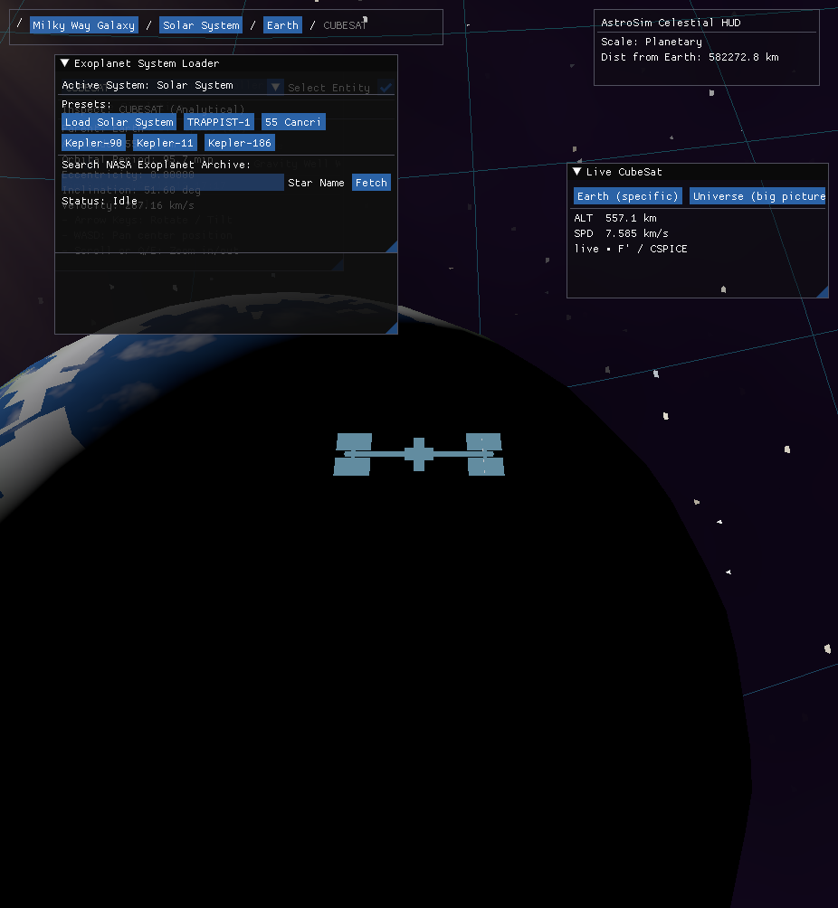
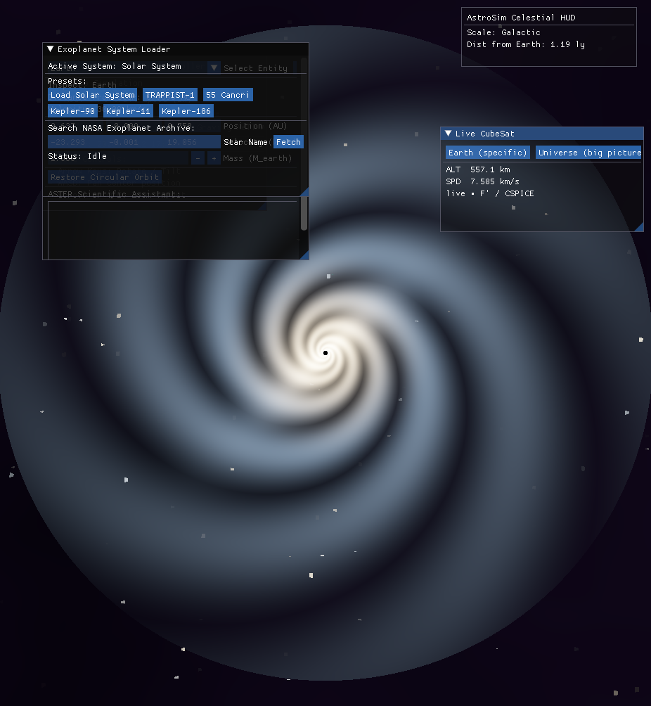

# AstroSim live CubeSat integration

[AstroSim](https://github.com/yahya-azeem/AstroSim) is a Rust/wgpu N-body
simulator with an ImGui front end. This integration adds a live 1U CubeSat
entity and a two-mode camera panel to its existing ImGui UI.

Pinned upstream: `upstream.sha` (AstroSim `626f71a`).

## Modes

| Mode | What happens |
|---|---|
| **Earth (specific)** | Camera targets the live CubeSat at `0.0004 AU`; Earth fills the background and the panel shows altitude and speed from `AstroNav`. |
| **Universe (big picture)** | Camera moves to `(0, 0, -12000) AU` at `65000 AU` (AstroSim's galactic scale), showing the full simulation. |

Both buttons live in the ImGui window **Live CubeSat**, top right.

## Geometry

The entity is rendered from the exact OpenSCAD export
(`integrations/astrosim/cubesat.stl`, 7,920 triangles), not a procedural
box. Vertices are centred and normalised, then drawn with AstroSim's
per-body model matrix.

True 1U dimensions are 113.5 mm, which is `7.6e-13 AU` — invisible at any
camera distance where Earth is visible. The marker therefore uses
`radius_render = 1e-5 AU` (about 1,500 km equivalent) purely for
visibility. Change it in `solar_system.json` if you want a smaller or
larger marker; the mesh geometry itself is unchanged.

## Embed / API

AstroSim can be embedded in an iframe and driven by its parent:

```html
<iframe src="http://localhost:8010/?mode=earth&endpoint=http://localhost:8787/state"></iframe>
```

| URL parameter | Meaning |
|---|---|
| `mode=earth` / `mode=universe` | initial view |
| `endpoint=...` | telemetry JSON source for the bridge |

JavaScript API on the iframe's `contentWindow`:

```js
AstroSim.setMode('earth' | 'universe' | 0 | 1);
AstroSim.getMode();          // 'earth' | 'universe'
AstroSim.getTelemetry();     // last {alt, speed, pos, velocity, ...} or null
AstroSim.ready;              // boolean
```

Cross-origin parents can use `postMessage`:

```js
iframe.contentWindow.postMessage({ type: 'astrosim:setMode', mode: 'universe' }, '*');
iframe.contentWindow.postMessage({ type: 'astrosim:getState' }, '*');
// child replies: { type: 'astrosim:state', mode, telemetry }
// child also emits { type: 'astrosim:ready' }
```

`integrations/astrosim/embed.html` is a working parent page with buttons,
mode status and a live telemetry dump.

## Data flow

```
F´ AstroNav (CSPICE)
        │  telemetry: PosX/Y/Z, VelX/Y/Z, AltKm, SpeedKmS
        ▼
GDS logs/fprime-gds-*/channel.log
        │  tail parsing
        ▼
integrations/orbit-view/serve.py  :8787/state   (JSON)
        │  fetch every 500 ms
        ▼
cubesat_bridge.js  (equatorial km → ecliptic m)
        │  set_cubesat_state(x, y, z, vx, vy, vz)
        ▼
AstroSim wasm  →  ImGui "Live CubeSat"  →  CUBESAT entity
```

The bridge rotates J2000 equatorial into AstroSim's ecliptic frame with the
23.439° obliquity.

## Patch contents

`cubesat.patch` applies to the pinned AstroSim commit and:

1. adds `CUBESAT` (`body_type 12`, 550 km LEO) to `src/solar_system.json`;
2. exports `set_cubesat_state(...)` and a `cubesat_state()` accessor from
   `src/lib.rs`;
3. overrides the Keplerian CUBESAT position/velocity in the render loop with
   the live state (applying AstroSim's parent visual scale);
4. adds the ImGui **Live CubeSat** panel with the two mode buttons;
5. loads `cubesat_bridge.js` from `index.html`.

Verify the patch against a clean tree:

```bash
git clone https://github.com/yahya-azeem/AstroSim.git /tmp/AstroSim-clean
git -C /tmp/AstroSim-clean checkout "$(cat upstream.sha)"
git -C /tmp/AstroSim-clean apply --check cubesat.patch
```

## Build

Prerequisites: Rust `wasm32-unknown-unknown`, Emscripten, `wasm-bindgen-cli`
matching the crate (`0.2.125`).

```bash
rustup target add wasm32-unknown-unknown
cargo install wasm-bindgen-cli --version 0.2.125 --locked
# emsdk: https://emscripten.org/docs/getting_started/downloads.html
export EMSDK=$HOME/emsdk

./integrations/astrosim/build-wasm.sh
```

The script clones AstroSim into `integrations/astrosim/upstream`, applies the
patch, copies the bridge, builds the wasm library, and runs `wasm-bindgen`.

## Run

Three processes:

```bash
# 1. F´ GDS with the deployment
make fprime-gds

# 2. telemetry bridge (AstroNav -> JSON)
python3 integrations/orbit-view/serve.py      # :8787

# 3. AstroSim wasm
python3 -m http.server 8000 --directory integrations/astrosim/upstream
# open http://localhost:8000/
```

Click **Earth (specific)** to follow the CubeSat orbit; click
**Universe (big picture)** to zoom out to the full simulation.

## Screenshots

| Earth | Universe |
|---|---|
|  |  |

## Notes

- AstroSim is built as a web target; the native build is untouched.
- If the bridge is not running, the entity keeps its Keplerian default and
  the panel shows `bridge offline`.
- The `CUBESAT` entry is a 550 km, 51.6° circular orbit, matching the demo SPK.
- The mesh is scaled as a visibility marker; its shape is the 1U OpenSCAD
  model, its size is not physical.
- No changes are pushed to the upstream AstroSim repository: this is a
  reproducible local patch.
